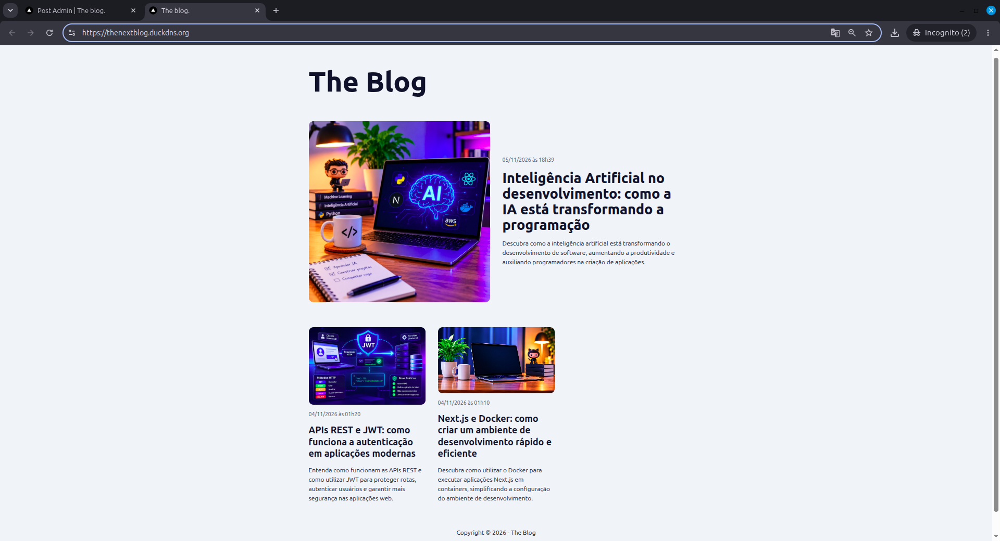
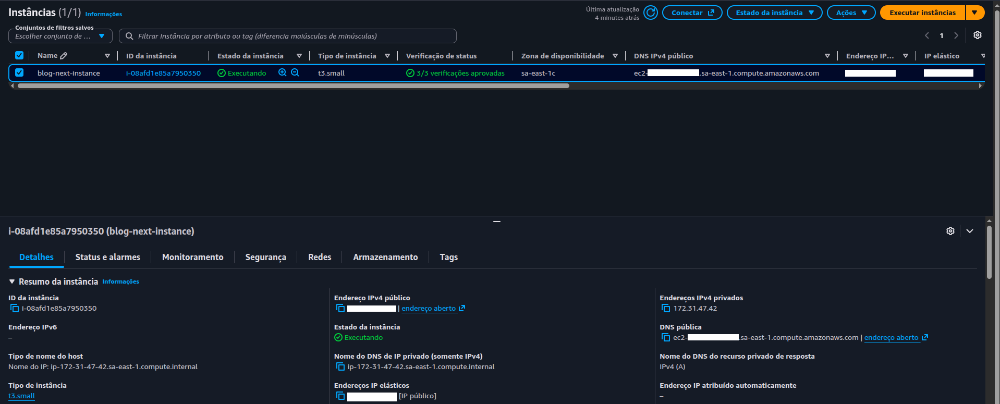
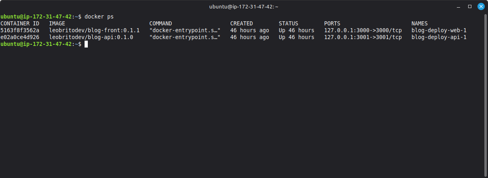

# Blog Deploy

Production deployment setup for the blog: a Next.js front end and a NestJS API, running as Docker containers on an AWS EC2 instance behind NGINX with HTTPS.

- Front end: [blog-nextjs](https://github.com/leo-dot-com-dot-br/blog-nextjs)
- API: [blog-nestjs-api](https://github.com/leo-dot-com-dot-br/blog-nestjs-api)

> The live demo is offline to keep infrastructure costs down. The screenshots below were taken from the deployed version.

## Screenshots







## Architecture

```
Browser  ->  NGINX (on the server, HTTPS via Certbot)  ->  front container (127.0.0.1:3000)
                                                      ->  API container   (127.0.0.1:3001)  ->  SQLite (./dados/db)
```

NGINX routes by path: `/uploads/` goes to the API, which serves the stored images, and everything else goes to the Next.js front end. The front end reaches the API over the internal Docker Compose network (`http://api:3001`), so the API's REST routes (login, posts, users) are not exposed on the public domain.

## Stack

- AWS EC2 (t3.small, Ubuntu, Elastic IP), region sa-east-1 (São Paulo)
- Docker and Docker Compose
- NGINX as reverse proxy, Certbot for HTTPS certificates
- Images published on Docker Hub: `leobritodev/blog-front`, `leobritodev/blog-api`
- Domain via DuckDNS

The images are built from the Dockerfile in each project repository and pushed to Docker Hub.

## Repository contents

| Path                                 | Purpose                                                                                |
| ------------------------------------ | -------------------------------------------------------------------------------------- |
| `docker-compose.prod.yml`            | Production services (front end and API)                                                |
| `api.env-EXAMPLE`, `web.env-EXAMPLE` | Templates for the environment variables of each container                              |
| `nginx/your_domain.conf`             | NGINX routing (HTTP only; Certbot adds the HTTPS block when it issues the certificate) |

## Deploying

1. **AWS network.** Create a security group that allows SSH (port 22) only from your own IP ranges, and HTTP (80) and HTTPS (443) from anywhere.
2. **Server.** Launch the EC2 instance with that security group and associate an Elastic IP with it.
3. **Domain.** Point the DuckDNS domain to the Elastic IP.
4. **Access.** Connect to the server over SSH with the `.pem` key and update the system packages.
5. **Docker.** Install Docker Engine and the Compose plugin (see the official Docker docs for Ubuntu). Recent Ubuntu images already include Git.
6. **Project.** Clone this repository and pull the images:
   ```bash
   docker compose -f docker-compose.prod.yml pull
   ```
7. **Data directories.** Create the directories for the database and the uploaded images: `dados/db` and `dados/uploads`.
8. **Configuration.** Create `api.env` and `web.env` from `api.env-EXAMPLE` and `web.env-EXAMPLE`. In `api.env`, set `JWT_SECRET` (a long random value) and set `CORS_WHITELIST` to the site's origin (`https://your_domain`). In `web.env`, set `IMAGE_SERVER_URL` to the same origin.
9. **Containers.** Start the services:
   ```bash
   docker compose -f docker-compose.prod.yml up -d
   ```
10. **NGINX.** Install NGINX and Certbot. Copy `nginx/your_domain.conf` to `/etc/nginx/sites-available/yourdomain`, link it into `sites-enabled`, and test the configuration:
    ```bash
    sudo ln -s /etc/nginx/sites-available/your_domain /etc/nginx/sites-enabled/
    sudo nginx -t
    ```
11. **HTTP check.** Reload NGINX and open the domain over HTTP. Certbot needs the site to answer on port 80 to validate the domain.
12. **HTTPS.** Issue the certificate with Certbot, then restart NGINX:
    ```bash
    sudo certbot --nginx -d your_domain
    sudo systemctl restart nginx
    ```

## Technical Decisions

**Fixed image tags, no build on the server.** The compose file pulls versioned images from Docker Hub (`blog-api:0.1.0`, `blog-front:0.1.1`) instead of using `latest` or a `build:` section. Each deploy runs a known version and a rollback is just a tag change. It also keeps the small t3.small instance from compiling both projects, which previously ran out of memory during the build.

**Ports bound to 127.0.0.1.** The containers publish their ports only on the server's loopback interface, so they are not reachable from the internet no matter what the firewall allows. The only public entry point is NGINX.

**NGINX and Certbot on the server, not in containers.** NGINX terminates HTTPS and routes requests by path, and Certbot issues and renews the certificate on the server. Certificates are therefore independent from the containers: updating an image never touches them.

**Only the front end talks to the API.** NGINX forwards just `/uploads/` to the API. Authentication and post routes are called by the Next.js server inside the Compose network, never directly from the browser.

**Data in bind mounts.** The SQLite database (`./dados/db`) and the uploaded images (`./dados/uploads`) are folders on the server mounted into the containers, not stored inside them. Replacing a container or changing a tag does not delete data. The database path is overridden with `DB_DATABASE` to point into the mounted directory, and the whole directory is mounted so SQLite's auxiliary files stay with the database.

**Upload limit set above the API's.** NGINX allows request bodies up to 2 MB (`client_max_body_size`), above the API's own 900 KB image limit. Oversized uploads are rejected by the API with its standard error format, instead of by NGINX with a generic 413.

**Configuration outside the compose file.** Each service loads its variables from an env file (`api.env`, `web.env`), so secrets such as `JWT_SECRET` never appear in the committed compose file.

**Automatic restart.** `restart: unless-stopped` brings the containers back after a crash or a server reboot.

## Limitations

- Deploys are manual: new versions are pulled and started by hand on the server. A CI/CD pipeline is planned.
- Single server and a single SQLite file: no redundancy, and a server failure takes the site down.
- No automated backups of the database or the uploaded images.
- No monitoring or alerts.
- Database schema is created by TypeORM synchronize (no migrations).
